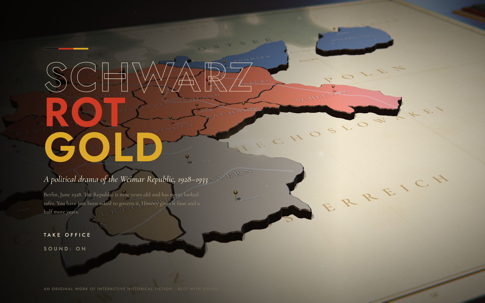
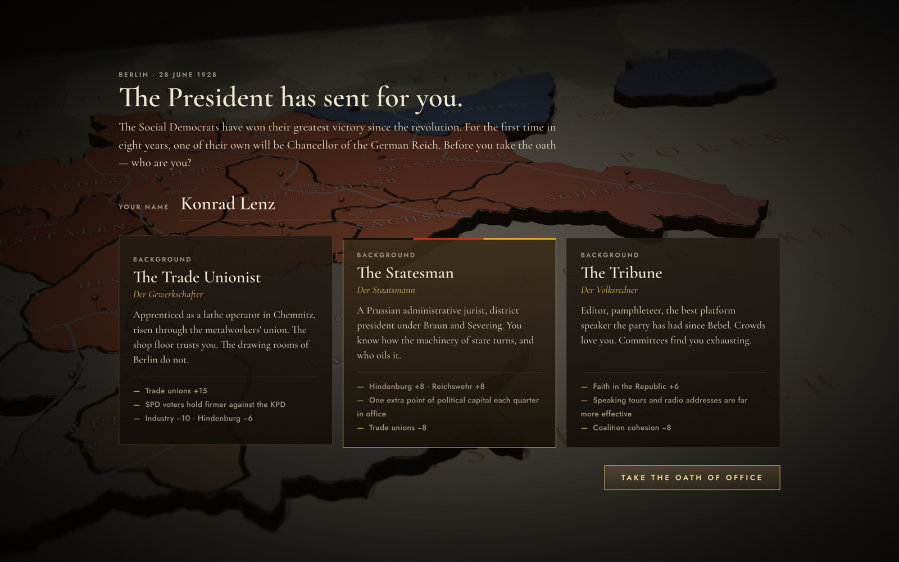
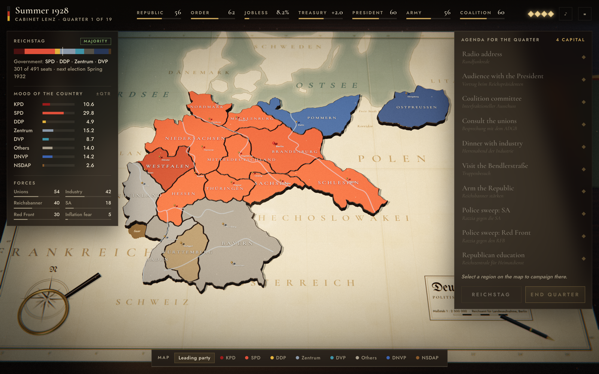
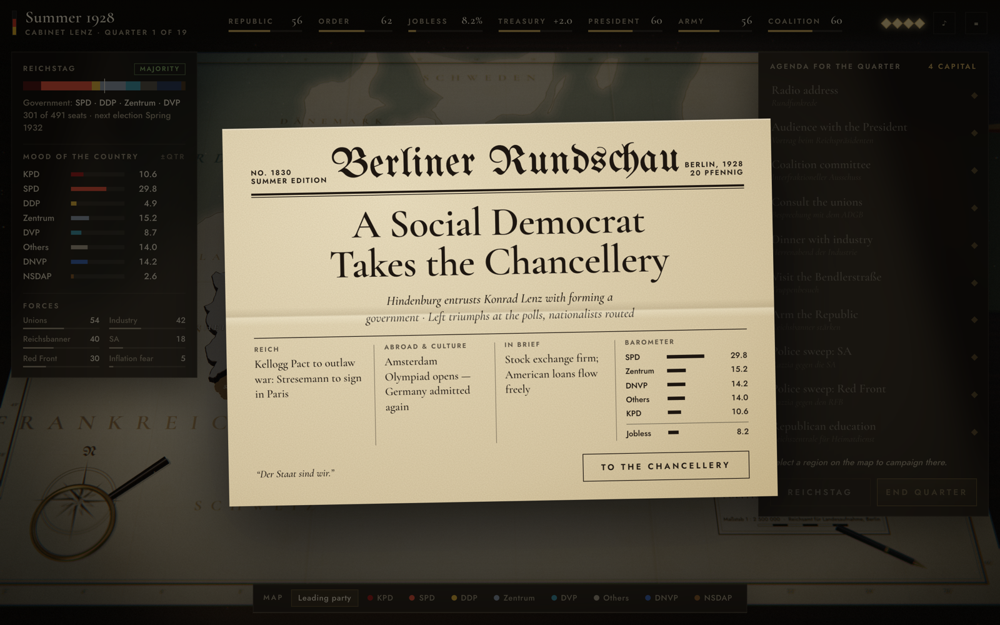
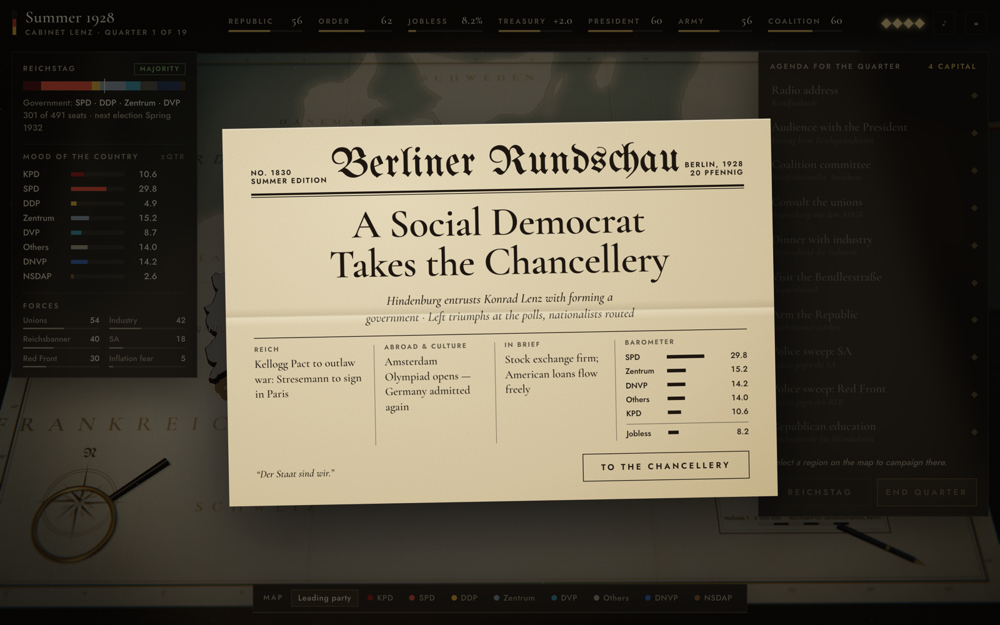

# 🇩🇪 Schwarz · Rot · Gold
### *A Political Drama of the Weimar Republic, 1928–1933*
### 黑 · 红 · 金 —— 魏玛共和国的政治悲剧

[](https://github.com/S7arFish/Fable5.2-Suzerain)
[](https://vitejs.dev/)
[](https://threejs.org/)
[](https://developer.mozilla.org/en-US/docs/Web/API/Web_Audio_API)
[](https://opensource.org/licenses/MIT)

> **"Die Freiheit und das Leben kann man uns nehmen, die Ehre nicht."**  
> *"自由与生命可以被剥夺，但尊严与荣誉不能。"*  
> —— 奥托·韦尔斯（Otto Wels），帝国议会反对《授权法》演说，1933年3月23日

---

## 🤖 项目生成声明与提示词 (Built with Fable 5.2)

> 📢 **声明**：本项目由 **Fable 5.2** 全程构建完成。从基于 Three.js 的三维复古沙盘与国会大厦、纯 Web Audio API 过程化声音合成引擎，到底层政治与选民经济模拟系统，均由 Fable 5.2 根据以下提示词生成与组织。

### 💬 原始提示词 (Original Prompt)
```text
I really love the game Suzerain and Weimar German history. Could you help me build a game similar to Suzerain? Something along the lines of Social Democracy: An Alternate History, set against the backdrop of the Weimar Republic. Ideally, it should be playable directly in the browser using tools like Three.js and WebGL. Visual quality and game feel are top priority—I want it to look and feel like a AAA title.
```

---

## 📖 游戏导言与背景 (Prologue & Context)

**《Schwarz · Rot · Gold》（黑·红·金）** 是一部致敬经典政治叙事模拟游戏 **《宗主国》（Suzerain）** 的深度历史戏剧作品。

游戏的故事始于 **1928 年 6 月的柏林**。魏玛共和国迎来了九岁生日，社民党（SPD）在国会大选中斩获 153 个席位，取得了自 1919 年国民议会以来的最大辉煌。老帅兴登堡总统派人请你前往总统府，受命组阁出任德意志国帝国总理（Reichskanzler）。

表面上，这似乎是共和国最安详的黄金年代——黄金二十年代的流光溢彩、美资贷款的源源涌入、斯特莱斯曼在国际舞台上的外交斡旋、现代主义艺术的蓬勃迸发。  
然而，冰山之下的暗流正撕裂着这个新生的民主政权：
- **鲁尔区钢铁工潮** 与工业巨头的正面对抗；
- **“装甲舰 A”** 的财政拨款在左翼誓言与军方忠诚间激起的巨浪；
- 柏林 **“血腥五月”（Blutmai）** 街头工人示威的枪声与裂痕；
- 1929 年华尔街崩盘点燃全球大萧条，数百万失业工人的绝望与面包长队；
- **哈尔茨堡阵线**（Harzburg Front）的极端右翼狂澜，冲锋队（SA）与红军斗争团（RFB）在街头的血腥厮杀；
- 总统身边卡玛利亚（Camarilla）寡头权谋的步步紧逼与 **《魏玛宪法》第 48 条紧急法令** 的达摩克利斯之剑……

**历史只给了共和国四年半的时间。你将如何力挽狂澜？**

---

## 📸 游戏截图 (Screenshots Gallery)

### 1. 标题画面 (Title Screen)
*置于黄铜台灯光晕之下的柏林总理府案桌与手工浮雕地图。*


### 2. 序章与总理出身抉择 (Prologue & Background)
*工会斗士（Der Gewerkschafter）、普鲁士文官政客（Der Staatsmann）还是平民演说家（Der Volksredner）？你的出身将塑造执政的根基与阻力。*


### 3. 内阁风云与机密公文 (Cabinet & Confidential Dossiers)
*面对国务秘书普恩德尔的席位算术，是组建横跨左中右的“大联合政府”，还是坚守纯粹的“魏玛联盟”？*


### 4. 全国地缘政治沙盘与施政议程 (Republic 3D Map & Agenda)
*17 个行政大区的选民偏好、各阶级力量对比、每季度的政治资本调配与关键改革法案。*


### 5. 帝国国会大厦 3D 全景议事厅 (Reichstag 3D Hemicycle)
*640 席半圆形大厅实时演算各党派席位增减、内阁多数与每一次生死攸关的表决风暴。*


---

## 🏛️ 核心玩法机制 (Core Gameplay & Systems)

### 1. 3D 地缘政治沙盘 (3D Relief Map of the Reich)
- **手绘拓扑与三维浮雕**：基于真实经纬度与历史疆界精准还原的 17 个行政区域（东普鲁士、波美拉尼亚、西里西亚、柏林、萨克森、巴伐利亚、莱茵兰等）及萨尔保护领。
- **选区民情与阶级结构**：每个邦国均拥有独立的城市化比率、天主教人口比率、农业人口比重与政党偏好模型。
- **动态选民摇摆模拟**：政策抉择将引发各阶层选民在八大阵营间的宏观漂移（Swing System）。

### 2. 帝国国会与法案表决 (Reichstag Hemicycle & Legislation)
- **3D 实例化排座**：半圆形会议厅精准还原真实议席排布，并支持各政党色彩可视化。
- **八大政治派系博弈**：
  - 🔴 **KPD（德国共产党）**：莫斯科路线，视社民党为“社会法西斯”；
  - 🌹 **SPD（德国社会民主党）**：玩家基本盘，共和国最坚实的支柱；
  - 🟡 **DDP（德国民主党）**：左翼自由派，忠诚的共和卫士，但选民基础日渐流失；
  - ⚪ **Zentrum（中央党 & 巴伐利亚人民党）**：天主教政治力量，任何执政多数不可或缺的基石；
  - 🔵 **DVP（德国人民党）**：国家自由派，重工业与资本家的代言人（斯特莱斯曼领导）；
  - 🟤 **OTH（经济党与小党派联合）**：中产阶级利益团体，极易在危机中激进化；
  - 🔷 **DNVP（国家人民党）**：报业巨头胡根贝格控制下的君主派与极端民族主义者；
  - 🟫 **NSDAP（国家社会主义工人党 / 纳粹党）**：1928 年国会仅占 12 席的边缘极端邪教，却伺机在大萧条中吞噬一切。
- **关键历史法案**：
  - 《共和国保卫法》（Republikschutzgesetz）
  - 《财政紧缩与整顿法案》（Sanierungsprogramm）
  - 《以工代赈公共工程法》（Arbeitsbeschaffungsgesetz）
  - 《建设性不信任案》宪法第 54 条修正案
  - 《每周四十小时工作制》（Vierzigstundenwoche）
  - **《WTB 计划》（WTB-Plan）**：由沃廷斯基（Woytinsky）、塔诺夫（Tarnow）与巴德（Baade）构想的先驱凯恩斯主义赤字信用扩张计划，投入 20 亿马克国家信贷换取百万工人重回工位！

### 3. 多重历史结局分支 (Nine Historical Endings)
你的每一次权衡都在拨动历史的天平：
1. 🌟 **Die Soziale Republik（社会民主共和国）**：成功击退萧条与民粹狂潮，以工代赈重塑信仰，宪政民主在风暴后破晓重生；
2. 🕊️ **Die Republik lebt（共和国长存）**：议会民主虽然满目疮痍、经济羸弱，但宪政之火未曾熄灭；
3. 🛡️ **Die wehrhafte Republik（武装堡垒共和国）**：依靠紧急法令与强权手段稳住局势，民主幸存却已变质；
4. 🌫️ **Am Abgrund（深渊边缘）**：勉力维持至 1933 年初，政局悬于一线，风雨飘摇；
5. 🌑 **Der 30. Januar（1933年1月30日）**：保守派引狼入室，希特勒在掌声与火炬游行中登上权力巅峰，拉开人类史上最黑暗一幕；
6. ⚔️ **Der General（将军的独裁）**：施莱谢尔发动军人政变，解散议会，建立国防军保护下的威权体制；
7. 👑 **Das Kabinett der Barone（贵族男爵内阁）**：巴本与容克寡头官僚接管政权，以一纸政令终结共和国；
8. ⏳ **Wie es geschah（历史之覆辙）**：如真实历史中的赫尔曼·穆勒内阁一样，因微弱分歧在大萧条前夜分崩离析；
9. ⚡ **Reichspräsident Hitler（希特勒当选总统）**：1932 年大选失守，狂人通过合法选票成为最高统帅，共和国门户洞开。

---

## 🎨 视听美学特色 (Aesthetics & Audio Engineering)

- **程序化 SVG 木刻肖像 (Procedural Linocut Busts)**：
  - 摈弃预渲染位图，全动态 SVG 参数化生成兴登堡、斯特莱斯曼、希法亭、格勒纳、施莱谢尔、布劳恩、沙赫特、希特勒、台尔曼等历史名人的粗砺木刻肖像，呈现魏玛时代特有的表现主义版画质感。
- **纯代码过程式音频系统 (Procedural Web Audio Engine)**：
  - **零音频外链与采样**，全由 Web Audio API 振荡器、卷积混响与动态滤波器实时生成；
  - 压抑低沉的 D 小调暗流交响乐，随政局紧张度动态变调；
  - 逼真的打字机嗒嗒声、黄铜图章盖印、议长法槌落击、羊皮纸翻动与时钟心跳拟音。
- **电影级后期调色着色器 (Cinematic Postprocessing)**：
  - 自定义着色器实现 ACESFilmic 色调映射、景深模糊、暗角（Vignette）、镜头色差（Chromatic Aberration）与胶片颗粒感。

---

## 🚀 本地运行与开发指南 (Getting Started)

### 环境依赖
- [Node.js](https://nodejs.org/) (推荐 v18+ 或最新 LTS)
- npm / yarn / pnpm

### 安装与启动
```bash
# 1. 克隆本仓库
git clone https://github.com/S7arFish/Fable5.2-Suzerain.git
cd Fable5.2-Suzerain

# 2. 安装依赖
npm install

# 3. 启动开发服务器
npm run dev

# 4. 构建生产发布包
npm run build
```
在浏览器中打开控制台输出的本地地址（默认 `http://localhost:5173`），佩戴耳机体验最佳！

---

## 📁 项目工程结构 (Repository Structure)

```text
├── index.html            # 主入口 HTML 与舞台挂载点
├── vite.config.js        # Vite 构建配置
├── package.json          # 项目依赖与启动脚本
├── docs/
│   └── screenshots/      # 游戏实机高清全景截图
├── scripts/
│   └── screenshot.js     # 自动化浏览器截屏脚本
└── src/
    ├── main.js           # 游戏生命周期、HUD 交互、事件状态机
    ├── styles.css        # 复古报刊风格排版与主题样式
    ├── audio.js          # Web Audio API 过程化声音合成引擎
    ├── engine/
    │   ├── data.js       # 历史政党、地理坐标、人口特征、历史人物数据库
    │   ├── sim.js        # 核心政治模拟、选民漂移计算、经济与失业模型
    │   ├── events.js     # 剧情事件树、重大历史决断与九大多元结局
    │   └── agenda.js     # 季度施政行动、内阁立法案卷与早间新闻系统
    ├── gfx/
    │   ├── stage.js      # Three.js 3D 地图桌案与国会大厅渲染引擎
    │   └── textures.js   # 过程式纸张纹理、木纹材质与几何投影工具
    └── ui/
        └── portraits.js  # 过程式木刻版画 SVG 肖像生成器
```

---

## 📜 许可证 (License)

本项目采用 [MIT License](LICENSE) 开源协议。

---

*“在柏林的细雨与落叶中，共和国的命运正握在你的手心。”*
